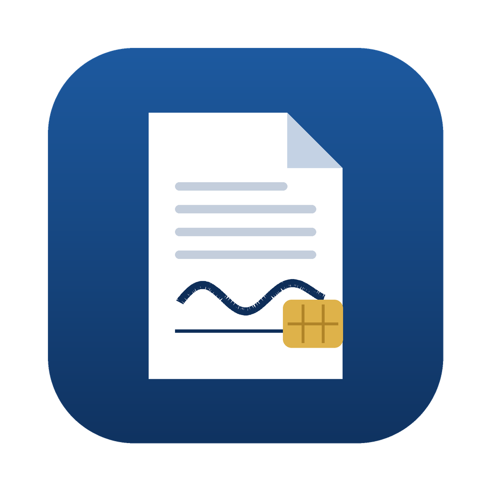
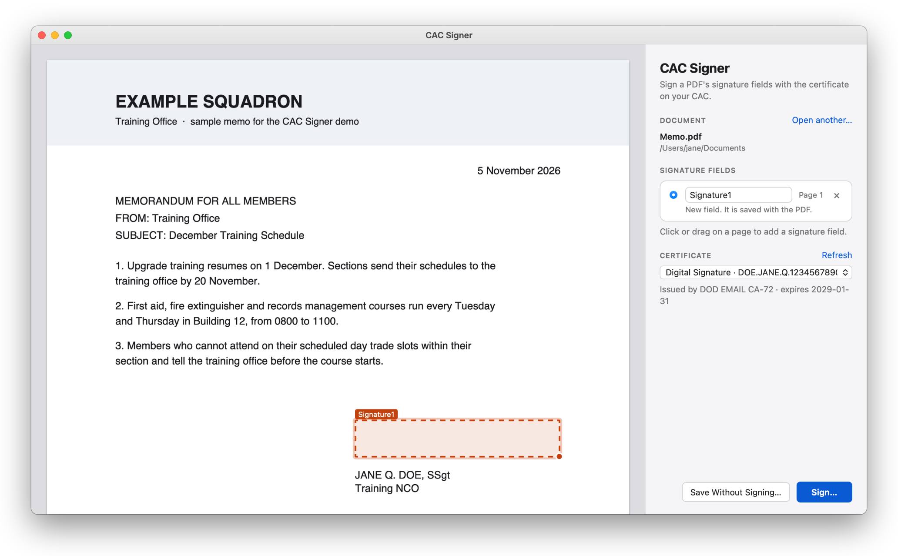
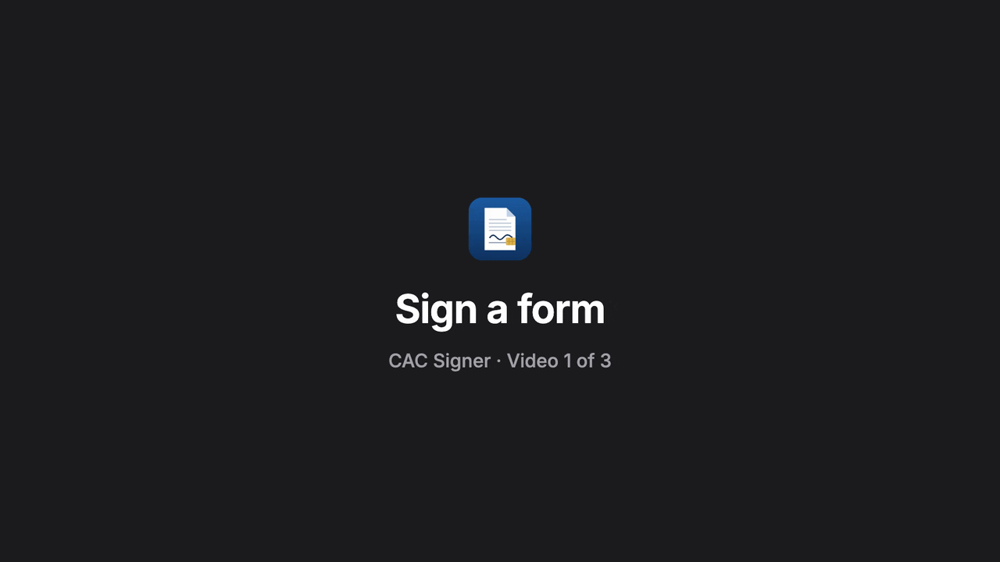
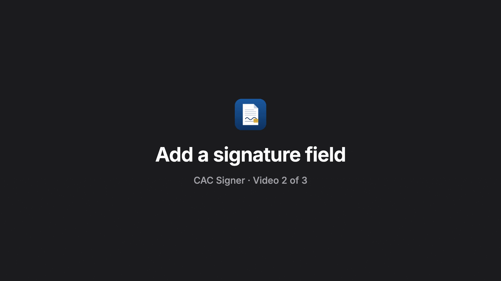
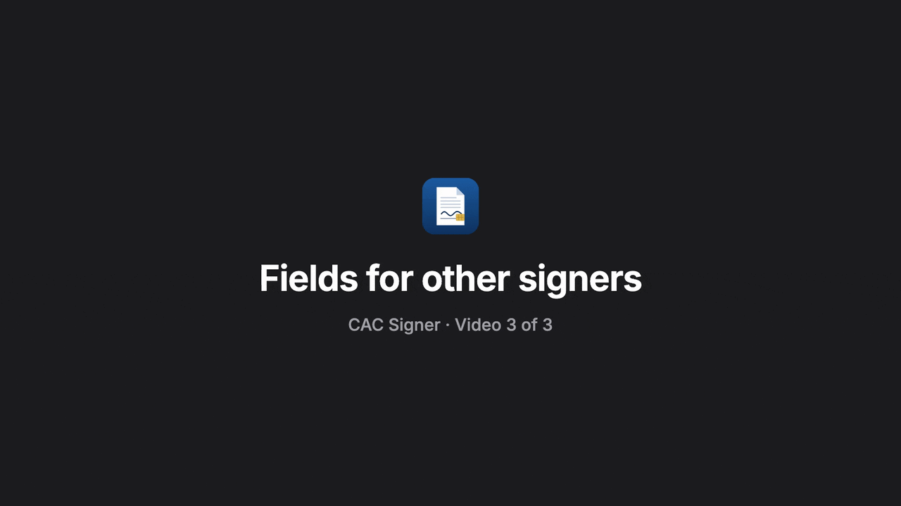
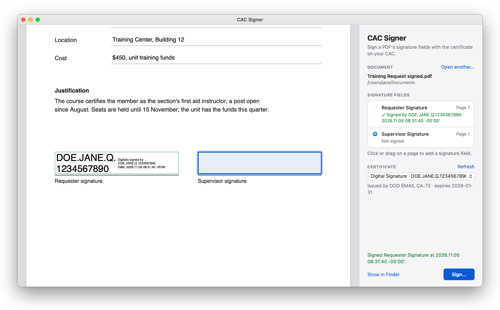
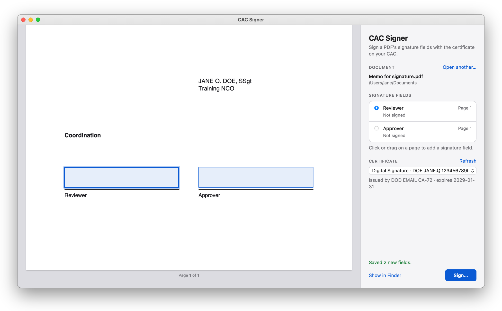
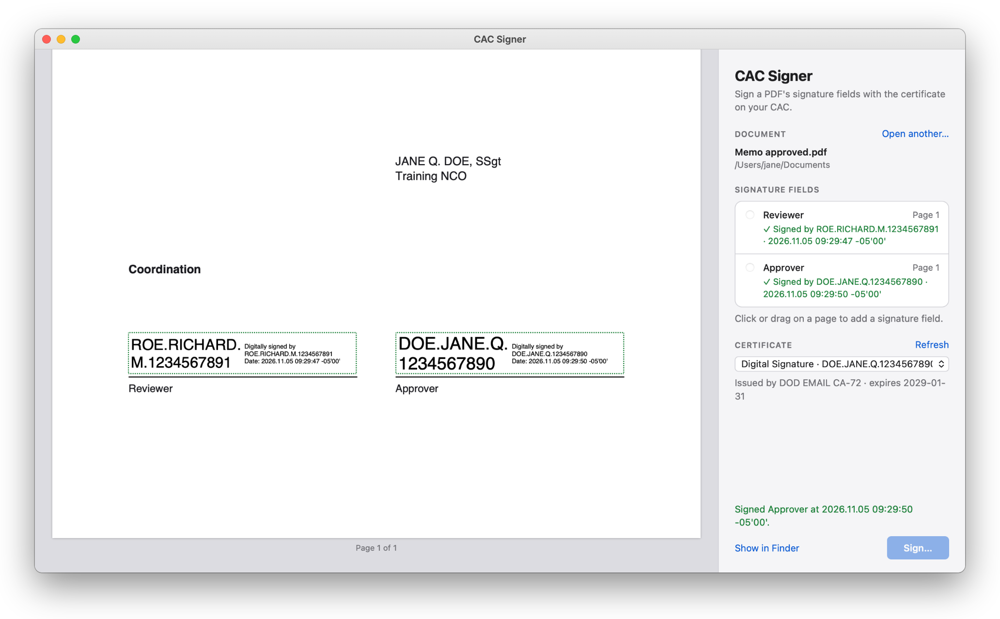

# CAC Signer

Sign PDFs with the certificate on your CAC, on a Mac, without Adobe Acrobat.



Open a PDF, pick its signature field or draw one where the signature goes, press Sign, and type your PIN in the window macOS shows. The signature is a standard PDF signature that Acrobat, Preview and other readers check, and the private key never leaves the card.

## Download

**[Download CAC Signer for Mac](https://github.com/andreisuslov/cac-signer/releases/latest/download/CAC-Signer.dmg)**, for Macs with Apple silicon or Intel and macOS 12 or later. A ZIP copy and older versions are on the [releases page](https://github.com/andreisuslov/cac-signer/releases).

1. Open the downloaded **CAC-Signer.dmg** and drag **CAC Signer** into **Applications**.
2. Open **CAC Signer** from Applications. The first time, macOS stops it and says it could not verify the app, because CAC Signer is not signed or notarized by Apple ([what that means](https://support.apple.com/en-us/102445)). Click **Done**.
3. Open **System Settings**, click **Privacy & Security**, and scroll down to **Security**. Next to "CAC Signer was blocked to protect your Mac", click **Open Anyway**, then confirm with your Mac's password or Touch ID. The button is there for about an hour after step 2.
4. If macOS asks once more, click **Open Anyway**. From then on, CAC Signer opens like any other app.

On macOS 12, the button is in System Preferences, under Security & Privacy, on the General tab. Apple's own guide to these steps is [Open a Mac app from an unknown developer](https://support.apple.com/guide/mac-help/open-a-mac-app-from-an-unknown-developer-mh40616/mac).

Signing and notarizing a Mac app takes a paid Apple Developer membership, which this free app does not have. Its code is all here, GitHub builds every download from it ([how to check](#check-a-download)), and you can [build the app yourself](#build-it-yourself) instead.

**Before you sign**, insert your CAC in a card reader your Mac recognizes. If Keychain Access shows your certificates when the card is in, CAC Signer can use them. To see DoD signatures as valid rather than "not trusted on this Mac", install the DoD root certificates in Keychain Access.

## Video instructions

Each video is under a minute. The GIFs below play here without sound; the links under them open the narrated version.

### 1. Sign a form



[▶ Watch with narration (0:50)](https://andreisuslov.github.io/cac-signer/videos/01-sign-a-form.mp4)

### 2. Add a signature field



[▶ Watch with narration (0:34)](https://andreisuslov.github.io/cac-signer/videos/02-add-a-field.mp4)

### 3. Fields for other signers



[▶ Watch with narration (0:36)](https://andreisuslov.github.io/cac-signer/videos/03-fields-for-others.mp4)

## What it does

- **Signs signature fields** with the Digital Signature certificate on your card. macOS asks for the PIN in its own window, so the app never sees it.
- **Adds signature fields.** Click a page for a field of the usual size, or drag to draw one. Move it, resize it from its corner, rename it, or remove it before saving.
- **Prepares PDFs for other people.** Save Without Signing writes the new fields empty, for others to sign later.
- **Checks signatures already in the file** and marks each one valid, not trusted on this Mac, or invalid.
- **Keeps earlier signatures valid.** Each change is added to the end of the file, and the parts that change are copied byte for byte with only the changed entries rewritten.

| A signed form | Fields ready for two other people | After the second signature |
| --- | --- | --- |
|  |  |  |

You can also open a PDF from Finder with Open With, or by dropping it on the app's icon in the Dock.

## How a signature is made

- The signature is a detached CMS signature (`adbe.pkcs7.detached`) over SHA-256, with your certificate and its chain up to the root, the same kind Acrobat makes.
- The visible stamp follows Acrobat's layout: your name large on the left, and "Digitally signed by", the name and the date on the right. On a rotated page it is turned to read upright.
- The PIN prompt comes first and the signing time after it, so a prompt left open does not make the recorded time early. The time comes from this Mac's clock; there is no timestamp server.
- The card-authentication key, which works without a PIN, is never offered for signing.

## PDFs it handles

The format tests (`tests/formats/run.py`) build PDFs the way different programs write them and sign each one twice. qpdf, pyHanko, Poppler and PDFKit then check that the earlier bytes are untouched, that every signature verifies, and that the stamp is drawn where the field was placed. They cover:

- PDFs from ReportLab, macOS Quartz, Preview, Chrome, cairo, Ghostscript (including PDF/A), ImageMagick scans, qpdf, pypdf and pyHanko
- compressed object streams, linearized files, earlier incremental updates, extra bytes after the end of the file
- rotated pages, rotation set on the page tree, cropped and shifted page boxes
- forms with text fields, forms with an XFA copy next to the regular pages, files signed before
- encrypted files that open without a password (AES-256, AES-128, RC4), whose security settings are followed
- certified files, whose certification level is followed

These are refused on purpose, with a message that says why:

- PDFs that need a password to open
- XFA-only forms, which only Acrobat can draw
- files certified or locked against the change you are making. A file that allows filling in forms but no other changes can have its existing fields signed, but no new ones added.

## Build it yourself

Building takes a few minutes the first time.

1. Install the Xcode command line tools (`xcode-select --install`), [Rust](https://rustup.rs) and [Node.js](https://nodejs.org).
2. Build the app:

   ```sh
   git clone https://github.com/andreisuslov/cac-signer.git
   cd cac-signer
   npm install
   npm run build
   ```

3. Drag `src-tauri/target/release/bundle/macos/CAC Signer.app` into Applications. An app you build yourself opens without the Open Anyway step.

## Check a download

GitHub builds each release from this code (`.github/workflows/release.yml`) and records which commit each file came from. With the [GitHub CLI](https://cli.github.com), you can check a download:

```sh
gh attestation verify CAC-Signer.dmg --repo andreisuslov/cac-signer
```

The release page also lists each file's SHA-256 checksum, which `shasum -a 256 CAC-Signer.dmg` prints for the file you have.

## Development

| Folder | What it holds |
| --- | --- |
| `src-tauri/src` | The Rust side: reading the card (`card.rs`), the PDF changes (`pdf.rs`, `raw.rs`), the stamp (`stamp.rs`) and page previews drawn by PDFKit (`render.rs`) |
| `ui` | The window: plain HTML, CSS and JavaScript |
| `tests/formats` | The format tests |
| `docs/lessons` | The video scripts |
| `films` | What makes the videos, GIFs and pictures ([manual](films/README.md)) |
| `.github` | The release workflow and the release notes |

```sh
npm run dev                             # run the app without bundling it
cd src-tauri && cargo test              # unit tests of the PDF code; no card needed
.venv/bin/python tests/formats/run.py   # the format tests
```

The format tests need Python with reportlab, pypdf, pyhanko and pillow (`python3 -m venv .venv && .venv/bin/pip install reportlab pypdf pyhanko pillow`), and qpdf and Poppler from Homebrew. Ghostscript, ImageMagick and Google Chrome are used when present.

To publish a new version, raise `version` in `src-tauri/tauri.conf.json`, `src-tauri/Cargo.toml` and `package.json`, then push a tag such as `v0.2.0`. The release workflow builds the app and publishes the release.

## License

[MIT](LICENSE)
